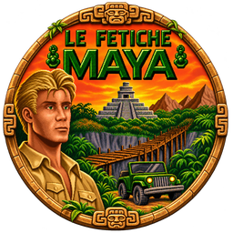
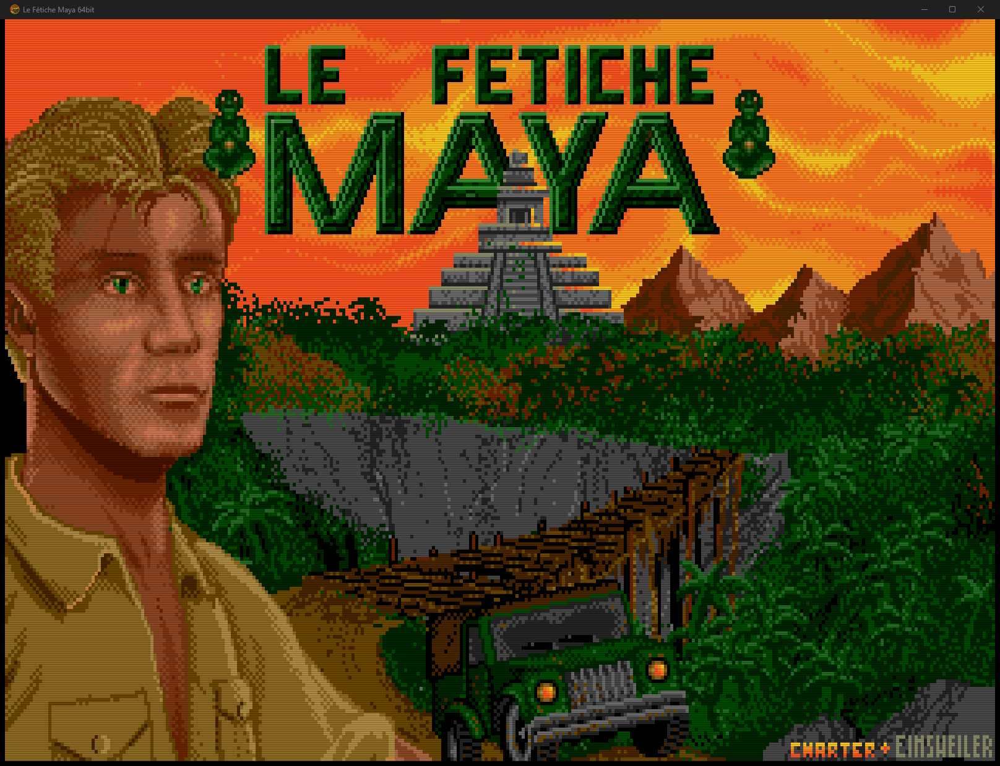
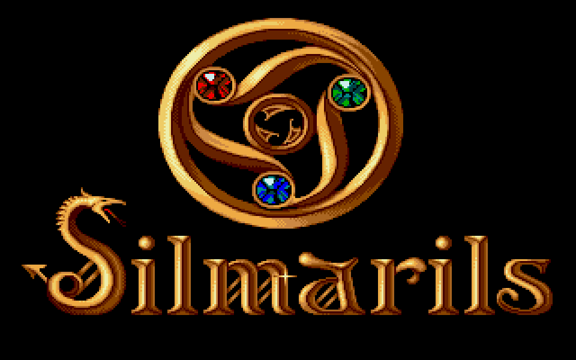
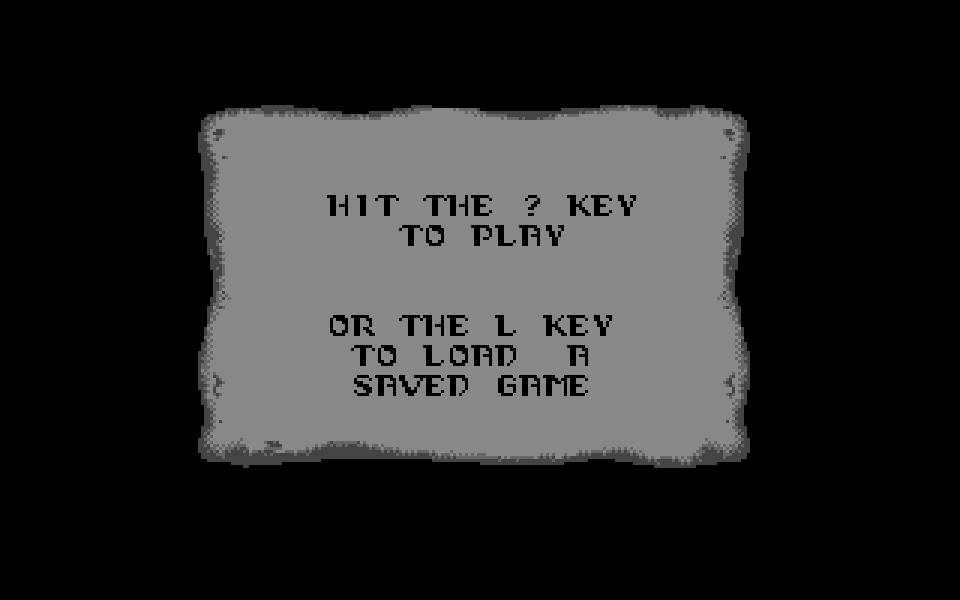
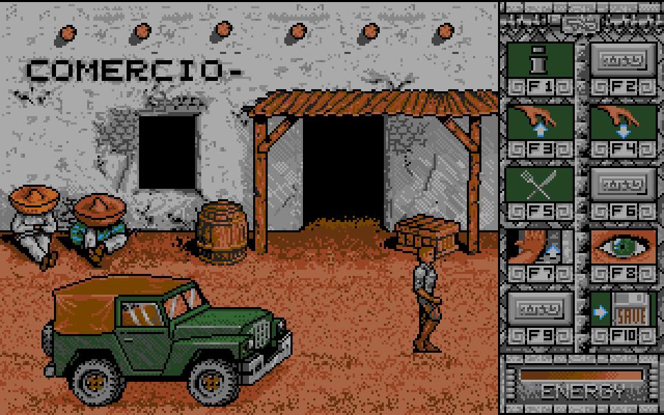

<p align="center"></p>

# Le Fétiche Maya 64bit

A native 64-bit port of **Le Fétiche Maya** (Silmarils, 1989), made by statically recompiling the Amiga version's
program to C. It is not an emulator with the game inside: the game's 68000 code is translated ahead of time and
runs as native code on a small model of the Amiga hardware it needs.

- **Windows x64**: released, [v1.0.0](https://github.com/Buyukcaglar/silmarils-maya/releases/latest).
- **macOS (universal)**: in progress, see [docs/MACOS-PORT.md](docs/MACOS-PORT.md).

**The game is not included.** You need your own copy of the original Amiga game's files.



| | | |
|---|---|---|
|  |  |  |

## Playing (Windows)

1. Download `maya64-1.0.0-win64.zip` from the [releases](https://github.com/Buyukcaglar/silmarils-maya/releases)
   and unpack it anywhere.
2. Have the Amiga game's data folder ready: the one that holds `MAIN.CO` and the other `.CO` files. In the WHDLoad
   package of the game it is `Maya\data`.
3. Start `maya64.exe`. The first time, it asks for that folder and remembers it. You can also copy the game's files
   next to `maya64.exe`, or start it with `--data <folder>`.

Windows 10 or 11, 64-bit. No installer and no other files are needed.

### Controls

The game is played with the Amiga joystick and a few keys.

| Action | Keyboard | Game controller (XInput) |
|---|---|---|
| Move the hero and the menu hand | Arrow keys, or the numeric keypad (7/9/1/3 are the diagonals) | D-pad or left stick |
| Fire / select | Left Ctrl, Right Ctrl, Numpad 0 or keypad Enter | A or B |
| Leave the logo | Any key | |
| Start a game | `?` | |
| Load the saved game | `L` at the start prompt | |
| The game's icons | F1 to F10 (F10 saves) | |
| Full screen | Alt+Enter | |

Letters and `?` follow your keyboard layout: press the key that types the character.

### Display and settings

The window's system menu (click the icon in the title bar, or press Alt+Space) holds the port's options:

- **Full screen** (Alt+Enter)
- **Integer scaling** or **Fit to window**
- **4:3 monitor aspect**: shows the 320×200 picture as it looked on a 4:3 monitor, instead of square pixels
- **CRT scanlines**
- **About…**

The window follows the Windows light or dark app theme. Settings are kept in `maya64.cfg` and saved games in
`saves\`, both next to `maya64.exe` (or in `%APPDATA%\Le Fetiche Maya 64bit` when that folder is read-only). The
game's own folder is never written to.

Command line: `--data <folder>`, `--crt 0|1`, `--aspect 4:3|square`.

## Building from source

You need Visual Studio 2022 or later (C++ tools), CMake, Ninja, Python 3.8 or later, and optionally LLVM (clang-cl is
used when present). You also need the Amiga game's `T.X`, the program that gets recompiled; it sits in the same
data folder.

```
build.cmd D:\Games\Maya\data
```

This generates C from your `T.X` into the build folder and builds `build\win\maya64.exe` (the game) and
`build\win\maya_cli.exe` (a headless runner for tests: scripted input, BMP screenshots, WAV sound). The recompiler
checks `T.X` against the version it was written for (the WHDLoad v1.4 package's file) and warns on a mismatch.

The application icon is built from `res/maya64-icon.png` with `python tools/make_icon.py` (needs Pillow); the
generated `res/maya64.ico` is in the repository, so a normal build does not need this step.

## How it works

| Path | Contents |
|---|---|
| `tools/m68k/` | The recompiler: hunk loader, 68000 decoder, control-flow analysis, C generator |
| `runtime/` | The Amiga the game needs: CPU state and dispatcher, custom chips (copper, bitplanes, blitter, Paula sound), CIAs, and the ~40 AmigaOS calls the game makes |
| `present/` | Scaling, 4:3 aspect and the CRT scanlines filter (portable C) |
| `host/win32/` | The Windows application: window, menu, theme, About box, input, sound output |
| `tests/` | `maya_cli`, the headless runner |
| `docs/` | Design and status: [RECOMP-PLAN.md](docs/RECOMP-PLAN.md), [HOST-DESIGN.md](docs/HOST-DESIGN.md), [DECISIONS.md](docs/DECISIONS.md), [RELEASE-NOTES.md](docs/RELEASE-NOTES.md) |

The game's program, `T.X`, is an interpreter for Silmarils' ALIS script language. The recompiler translates it to
C functions that keep the 68000's registers and stack exactly, with cycle counts so that interrupts, the display
and the sound run on the original timing. The scripts, pictures, sounds and music are read from the game's own
files at run time, unchanged.

## What is and is not in this repository

- In: the port's own code, documentation, and a few screenshots.
- Not in: any file of the game, and no C generated from it. The released `maya64.exe` necessarily contains the
  translated interpreter, as any static recompilation's binary does; it contains none of the game's scripts,
  pictures, sounds or music, and does nothing without the original game's files.

## Credits and licence

Le Fétiche Maya is by Silmarils (Claude Cazenave, Louis-Marie Rocques, Valérie Vasseur, Yves Pierog,
J-Christophe Charter, Bruno Blanchet). The game belongs to its owners.

The 64-bit version is by Onur BUYUKCAGLAR, with Anthropic Claude AI assistance. The port's own code is under the
[MIT licence](LICENSE), which also lists the acknowledgements (the WHDLoad installer by Mr.Larmer and CFou!,
DOSBox Pure Unleashed's CRT filter by Bernhard Schelling, and maestun's ALIS interpreter as a format reference).
